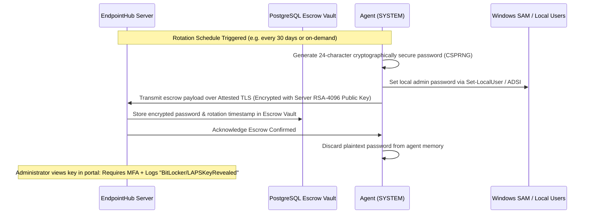
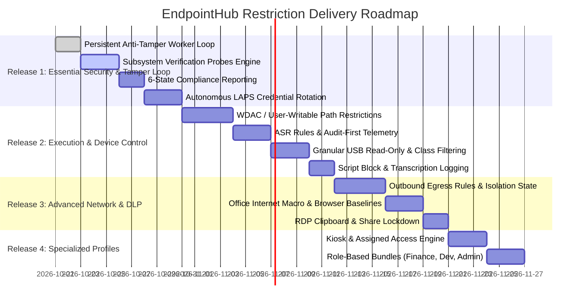

# EndpointHub: Master Windows Endpoint Restriction Catalogue & Persistent Enforcement Architecture

**Target Platform:** Windows 10/11 Pro, Enterprise, Education, and Server (Domain-Independent Architecture)  
**System Role:** Autonomous, Zero-Trust Endpoint Management System  
**Document Status:** Architecture & Implementation Plan  

---

## 1. Executive Architecture Overview

In a domain-independent (non-Active Directory / non-Intune) environment, the EndpointHub agent functions as a **Local System Security Principal** (`NT AUTHORITY\SYSTEM`). Enforcement cannot rely on Group Policy Objects (GPOs) pushed by Domain Controllers. Instead, EndpointHub implements **direct, native Windows subsystem enforcement** coupled with a **continuous, local anti-tamper verification loop**.

### Core Architecture Principles

```mermaid
graph TD
    subgraph Management Server
        P[Policy Engine / Catalog] -->|Signed SignalR / TLS| D[Policy Distribution Worker]
        A[Audit & Security Log] <--|Compliance & Drift Reports| H[Agent Hub]
        E[LAPS & Escrow Vault] <--|Encrypted Credential Rotations| H
    end

    subgraph Windows Endpoint Agent
        H <-->|Attested TLS| CS[Heartbeat & Sync Client]
        CS -->|Delivers Policy| PE[Policy Enforcement Service]
        PE -->|Saves Golden Baseline| PC[(Local Policy Cache)]
        
        subgraph Persistent Anti-Tamper Loop
            TW[Periodic Drift Worker - 15m] -->|Reads| PC
            TW -->|Probes Real OS State| VP[Verification Engine]
            VP -->|Checks Drift| DC{Drift / Tamper Detected?}
            DC -->|Yes: Mismatch| RM[Automatic Remediation]
            RM -->|Re-apply Native Control| NS[Native Subsystems]
            DC -->|Yes: Alert Server| CS
            DC -->|No: All Valid| OK[Status: Compliant]
        end

        NS -->|Registry / SecEdit / WMI / Defender / WDAC| OS[Windows OS Subsystems]
    end
```

---

## 2. Persistent Enforcement & Anti-Tamper Engine

### 2.1 The Problem with "Push-Once" Enforcement
Traditional MDM and push-based scripts apply a setting once. If a local user with administrative access, a malicious installer, or malware reverses the registry key or stops a service, the device silently drifts into a non-compliant state until the server happens to trigger a full re-application.

### 2.2 Client-Side Drift Detection Loop
The EndpointHub Agent runs a dedicated background timer (`PolicyDriftWatcherWorker`) that executes every **15 minutes** (configurable 5–60 min):

1. **Local Golden Cache:** The last validated policy is persisted in `%ProgramData%\EndpointHub\Agent\policy-last.json` with strict ACLs (`SYSTEM` and `Administrators` full control; standard users denied).
2. **Offline Resilience:** If the server or network goes down, the agent continues enforcing and verifying against the local golden cache.
3. **Verification Probes (Probe != Write):** Rather than blindly re-writing settings (which causes unnecessary disk I/O, event log spam, and service restarts), the engine **probes** the actual live subsystem state.
4. **Autonomous Remediation:** If `ProbeValue != DesiredValue`, the engine:
   - Flags the specific setting as `Drifted / NonCompliant`.
   - Executes the native remediation action to restore desired state.
   - Re-probes to confirm successful re-enforcement.
   - Emits a high-severity local event and transmits a `PolicyDriftDetected` audit alert to the server.

### 2.3 Comprehensive Compliance State Machine

EndpointHub adopts a 6-state compliance model matching industry best practices:

| Compliance State | Criteria | Agent Action |
|---|---|---|
| **`Compliant`** | All active policy settings verified effective on the system. | Reports OK; logs verification timestamp. |
| **`NonCompliant`** | One or more settings drifted from desired state, or auto-remediation was blocked. | Triggers auto-remediation; alerts server. |
| **`PendingReboot`** | Setting applied successfully (e.g. computer rename, HVCI/VBS, BitLocker startup key), but requires OS restart. | Maintains pending flag; prompts user or honors reboot schedule. |
| **`Unsupported`** | Hardware or Windows edition lacks prerequisite (e.g., TPM 2.0 missing, Credential Guard on Windows Home). | Bypasses enforcement; reports lack of capability without failing policy bundle. |
| **`Failed`** | Execution error during enforcement (e.g. access denied, WMI corruption, corrupt syntax). | Records exception stack trace; logs audit failure. |
| **`Unknown`** | Endpoint freshly enrolled or agent service restarted; initial verification probe pending. | Enqueues immediate verification task. |

---

## 3. Domain-Independent LAPS (Local Administrator Password Solution)

Because EndpointHub does not require Active Directory or Microsoft Entra ID, Windows LAPS cannot be used directly. EndpointHub implements an **Autonomous Enterprise LAPS Engine**:



1. **Entropy & Complexity:** Passwords generated using `System.Security.Cryptography.RandomNumberGenerator` (24+ characters, alphanumeric + symbols, excluding ambiguous characters).
2. **Escrow Before Invalidation:** The agent verifies the server has acknowledged and committed the new password to PostgreSQL before clearing the rotation transaction.
3. **Zero-Knowledge Architecture:** Escrowed credentials are encrypted using an envelope encryption model with server-held keys or master recovery keys.
4. **Audited Access:** Retrieving the local admin password requires `Admin` or `Owner` role, prompts for a mandatory reason, and triggers an immutable `AdminPasswordEscrowRevealed` audit event.

---

## 4. Master Restriction Catalogue (Domains A – Q)

Every control is assigned:
- **Priority:** `P0` (Mandatory), `P1` (Strongly Recommended), `P2` (Role-Based).
- **Enforcement Subsystem:** Registry, NetFirewall, DefenderApi, WMI, AppControl (WDAC), SecEdit, Powershell.
- **Verification Probe:** How the agent independently checks whether the control is active.
- **Safety Guard:** Rules preventing server/administrator lockout.

---

### A. User Accounts and Authentication

| ID | Control / Setting Key | Priority | Native Windows Enforcement Mechanism | Verification Probe | Safety Guard & Lockout Prevention |
|---|---|---|---|---|---|
| **A-01** | `local_admin_membership_restrict` | P0 | NetAPI32 / `Remove-LocalGroupMember` | Query `Get-LocalGroupMember -Group 'Administrators'` against approved list | **CRITICAL:** `ServerSafetyGuard` verifies that the active management service account and at least one designated recovery administrator are NEVER removed. |
| **A-02** | `disable_guest_account` | P0 | `Disable-LocalUser -Name 'Guest'` | `Get-LocalUser -Name 'Guest'` -> `Enabled == false` | Safe to enforce universally. |
| **A-03** | `minimum_password_length` | P0 | `net accounts /minpwlen:N` | Run `net accounts` and parse `Minimum password length` | Clamped to range `[8, 64]`. Minimum 8 for standard; 14+ for administrative workstations. |
| **A-04** | `password_complexity` | P0 | `secedit /export /cfg temp.inf` -> set `PasswordComplexity = 1` -> `secedit /configure /db secedit.sdb /cfg temp.inf` | Export `secedit` security baseline and inspect `PasswordComplexity` token | Non-disruptive to existing active sessions; applies on next password change. |
| **A-05** | `account_lockout_threshold` | P0 | `net accounts /lockoutthreshold:N` (default: 5) | Parse `net accounts` -> `Lockout threshold` | Must be accompanied by `lockoutduration:15` and `lockoutwindow:15`. Avoid lockout on service accounts. |
| **A-06** | `screen_lock_timeout_secs` | P0 | `HKLM\SOFTWARE\Microsoft\Windows\CurrentVersion\Policies\System` (`InactivityTimeoutSecs`) | Read DWORD `InactivityTimeoutSecs` | Values < 60s clamped to 300s to avoid instant lockouts. Skipped on kiosk/signage profiles. |
| **A-07** | `uac_elevation_prompt` | P0 | `HKLM\SOFTWARE\Microsoft\Windows\CurrentVersion\Policies\System` (`ConsentPromptBehaviorAdmin` = 2, `EnableLUA` = 1) | Read registry DWORDs | Never disable LUA on management server or client. |
| **A-08** | `laps_password_rotation` | P0 | EndpointHub Agent CSPRNG generator + `Set-LocalUser` | Compare `LastRotatedUtc` against policy max age (e.g. 30 days) | Validates escrow receipt from server before dropping transaction cache. |

---

### B. Windows OS & Platform Hardening

| ID | Control / Setting Key | Priority | Native Windows Enforcement Mechanism | Verification Probe | Safety Guard & Lockout Prevention |
|---|---|---|---|---|---|
| **B-01** | `require_secure_boot` | P0 | UEFI Firmware baseline validation | `Confirm-SecureBootUEFI` PowerShell cmdlet | Audit-only on machines where UEFI is unavailable (legacy BIOS). Never attempt to toggle in software (requires physical reboot/UEFI). |
| **B-02** | `require_tpm_2_0` | P0 | WMI: `ROOT\CIMv2\Security\MicrosoftTpm` (`Win32_Tpm`) | Query `Win32_Tpm.SpecVersion` -> Must start with `2.0` | Mark `Unsupported` if motherboard lacks TPM; report to server without failing compliance bundle. |
| **B-03** | `bitlocker_system_drive` | P0 | `Enable-BitLocker -MountPoint 'C:' -EncryptionMethod XtsAes256 -UsedSpaceOnly` | `(Get-BitLockerVolume -MountPoint 'C:').ProtectionStatus == 'On'` | **MUST verify BitLocker recovery key escrow in database BEFORE declaring Compliant.** |
| **B-04** | `enable_vbs_hvci` | P1 | `HKLM\SYSTEM\CurrentControlSet\Control\DeviceGuard` (`EnableVirtualizationBasedSecurity` = 1, `HypervisorEnforcedCodeIntegrity` = 1) | `Get-CimInstance -ClassName Win32_DeviceGuard -Namespace root\Microsoft\Windows\DeviceGuard` (`SecurityServicesRunning`) | Requires hardware virtualization support in CPU/BIOS. Requires `PendingReboot` state. |
| **B-05** | `enable_credential_guard` | P1 | `HKLM\SYSTEM\CurrentControlSet\Control\Lsa` (`LsaCfgFlags` = 1) | Query `Win32_DeviceGuard.SecurityServicesRunning` contains `1` | Requires Windows Enterprise or Education edition; mark `Unsupported` on Windows Pro/Home. |
| **B-06** | `disable_smbv1` | P0 | `HKLM\SYSTEM\CurrentControlSet\Services\LanmanServer\Parameters` (`SMB1` = 0) + `Disable-WindowsOptionalFeature -FeatureName SMB1Protocol` | Read DWORD `SMB1` and verify LanmanServer parameter | Universal baseline standard. Completely blocks WannaCry/EternalBlue vectors. |
| **B-07** | `disable_powershell_v2` | P0 | `Disable-WindowsOptionalFeature -Online -FeatureName MicrosoftWindowsPowerShellV2Root` | `(Get-WindowsOptionalFeature -Online -FeatureName MicrosoftWindowsPowerShellV2Root).State == 'Disabled'` | Prevents bypass of modern PowerShell transcription and AMSI scanning. |

---

### C. Antivirus, Malware & Ransomware Protection

| ID | Control / Setting Key | Priority | Native Windows Enforcement Mechanism | Verification Probe | Safety Guard & Lockout Prevention |
|---|---|---|---|---|---|
| **C-01** | `defender_realtime_monitoring` | P0 | `Set-MpPreference -DisableRealtimeMonitoring $false` | `(Get-MpComputerStatus).RealTimeProtectionEnabled == $true` | Always enforce `true` across all endpoints. |
| **C-02** | `defender_cloud_protection` | P0 | `Set-MpPreference -MAPSReporting Advanced` | `(Get-MpPreference).MAPSReporting == 2` | Ensures cloud-delivered heuristics block zero-day threats within milliseconds. |
| **C-03** | `defender_pua_protection` | P0 | `Set-MpPreference -PUAProtection Enabled` | `(Get-MpPreference).PUAProtection == 1` | Blocks adware, coin miners, and untrusted toolbars. |
| **C-04** | `defender_network_protection` | P0 | `Set-MpPreference -EnableNetworkProtection Enabled` | `(Get-MpPreference).EnableNetworkProtection == 1` | Blocks outbound connections to phishing/C2 domains at IP/DNS layer. |
| **C-05** | `defender_asr_rules` | P1 | `Set-MpPreference -AttackSurfaceReductionRules_Ids <GUIDs> -AttackSurfaceReductionRules_Actions Enabled` | Compare active ASR GUIDs in `Get-MpPreference` | Enable in **Audit Mode** first for 7 days before switching to **Block**. Key rules: block executable content from email, block Office child process creation, block credential stealing from LSASS. |
| **C-06** | `defender_controlled_folders` | P1 | `Set-MpPreference -EnableControlledFolderAccess Enabled` | `(Get-MpPreference).EnableControlledFolderAccess == 1` | Anti-ransomware folder lockdown. Requires whitelisting business software paths. |

---

### D. Application Installation & Execution Control

| ID | Control / Setting Key | Priority | Native Windows Enforcement Mechanism | Verification Probe | Safety Guard & Lockout Prevention |
|---|---|---|---|---|---|
| **D-01** | `block_user_writable_exec` | P0 | Software Restriction Policies (SRP) / AppLocker path rules denying `*.exe`, `*.dll`, `*.bat` in `%AppData%`, `%LocalAppData%`, `%Temp%`, `Downloads` | Probe registry under `HKLM\SOFTWARE\Policies\Microsoft\Windows\Safer\CodeIdentifiers\Paths` | **Safety Guard:** Whitelist corporate deployment directories (`%ProgramFiles%`, `%ProgramFiles(x86)%`, `%SystemRoot%`, `%ProgramData%\EndpointHub`). |
| **D-02** | `wdac_application_control` | P1 | Windows Defender Application Control (WDAC) XML/CIP binary deployed to `%SystemRoot%\System32\CodeIntegrity\CiPolicies\Active` | Query `Get-CimInstance -Namespace root\Microsoft\Windows\CI -ClassName CiPolicyStatus` | **Mandatory Canary Workflow:** Always deploy WDAC in **Audit Mode (`<Option>Enabled:Audit Mode</Option>`)** first. Enforce only after review of code integrity event logs. |
| **D-03** | `block_remote_access_tools` | P1 | Execution hash & path deny list (AnyDesk, TeamViewer, UltraVNC, LogMeIn, unless approved) | Scan running processes and test file execution rules | Prevents shadow IT and unmanaged remote control backdoors. |

---

### E. Command-Line Tools, Scripting & Administrative Utilities

| ID | Control / Setting Key | Priority | Native Windows Enforcement Mechanism | Verification Probe | Safety Guard & Lockout Prevention |
|---|---|---|---|---|---|
| **E-01** | `powershell_script_block_logging` | P0 | `HKLM\SOFTWARE\Policies\Microsoft\Windows\PowerShell\ScriptBlockLogging` (`EnableScriptBlockLogging` = 1) | Read registry DWORD `EnableScriptBlockLogging` | Captures full de-obfuscated script content to Microsoft-Windows-PowerShell/Operational event log. Zero user impact. |
| **E-02** | `powershell_transcription_logging` | P1 | `HKLM\SOFTWARE\Policies\Microsoft\Windows\PowerShell\Transcription` (`EnableTranscripting` = 1, `OutputDirectory` = `C:\EndpointHub\Transcripts`) | Read registry transcription keys and verify secure ACL on output directory | Audits all interactive terminal activity. Directory must have `SYSTEM` write-only access. |
| **E-03** | `powershell_constrained_language` | P1 | System environment variable `__PSLockdownPolicy = 4` or WDAC Constrained Language | `$ExecutionContext.SessionState.LanguageMode` | **Never apply to management server.** Only apply to role-based restricted workstations. |
| **E-04** | `restrict_script_hosts` | P1 | `HKLM\SOFTWARE\Microsoft\Windows Script Host\Settings` (`Enabled` = 0) to disable `wscript.exe` / `cscript.exe` | Read DWORD `Enabled` in WSH settings | Blocks legacy VBScript malware droppers. |

---

### F. Windows Firewall & Network Restrictions

| ID | Control / Setting Key | Priority | Native Windows Enforcement Mechanism | Verification Probe | Safety Guard & Lockout Prevention |
|---|---|---|---|---|---|
| **F-01** | `firewall_all_profiles_enabled` | P0 | `Set-NetFirewallProfile -Profile Domain,Public,Private -Enabled True` | Query `(Get-NetFirewallProfile).Enabled` -> All true | Fundamental baseline requirement. |
| **F-02** | `firewall_default_inbound_block` | P0 | `Set-NetFirewallProfile -Profile Domain,Public,Private -DefaultInboundAction Block` | Query `(Get-NetFirewallProfile).DefaultInboundAction` -> All `Block` | Blocks unsolicited lateral movement from compromised peers. |
| **F-03** | `restrict_rdp_remote_desktop` | P0 | `HKLM\SYSTEM\CurrentControlSet\Control\Terminal Server` (`fDenyTSConnections` = 1) or restricted to approved IP ranges | Read `fDenyTSConnections` and inspect inbound port 3389 firewall rule | Disabled by default. Only enabled when an active support session is approved. |
| **F-04** | `network_quarantine_isolation` | P0 (Action) | `New-NetFirewallRule -DisplayName "EndpointHub-Quarantine" -Direction Outbound -Action Block` with exception ONLY for Server IP:8443 | Test network reachability outside server IP | Used for incident response to sever lateral spread while maintaining management channel. |

---

### G. USB Devices, Removable Storage & Peripherals

| ID | Control / Setting Key | Priority | Native Windows Enforcement Mechanism | Verification Probe | Safety Guard & Lockout Prevention |
|---|---|---|---|---|---|
| **G-01** | `usb_mass_storage_block` | P0 / P1 | `HKLM\SYSTEM\CurrentControlSet\Services\USBSTOR` (`Start` = 4) + `HKLM\SOFTWARE\Policies\Microsoft\Windows\RemovableStorageDevices` (`Deny_All` = 1) | Read registry DWORDs | **Safety Guard:** Does NOT touch USB Human Interface Devices (HID keyboards, mice), smart cards, or YubiKeys (different device classes). |
| **G-02** | `usb_read_only_enforcement` | P1 | `HKLM\SYSTEM\CurrentControlSet\Control\StorageDevicePolicies` (`WriteProtect` = 1) | Read DWORD `WriteProtect` | Allows employees to read files from approved USB drives without exfiltrating confidential data. |
| **G-03** | `block_mtp_ptp_mobile_transfer` | P1 | `HKLM\SOFTWARE\Policies\Microsoft\Windows\RemovableStorageDevices\{6AC27878-A6FA-4155-BA85-F98F491D4F33}` (`Deny_All` = 1) | Read registry Deny_All DWORD for WPD class | Blocks dragging files onto Android/iPhone via MTP protocol. |
| **G-04** | `disable_autorun_autoplay` | P0 | `HKLM\SOFTWARE\Microsoft\Windows\CurrentVersion\Policies\Explorer` (`NoDriveTypeAutoRun` = 255) | Read DWORD `NoDriveTypeAutoRun` | Eliminates USB AutoRun worm execution vectors. |

---

### H. Data Loss Prevention (DLP) & Information Handling

| ID | Control / Setting Key | Priority | Native Windows Enforcement Mechanism | Verification Probe | Safety Guard & Lockout Prevention |
|---|---|---|---|---|---|
| **H-01** | `disable_administrative_shares` | P0 | `HKLM\SYSTEM\CurrentControlSet\Services\LanmanServer\Parameters` (`AutoShareWks` = 0) | Read DWORD `AutoShareWks` | Eliminates hidden `C$`, `ADMIN$` lateral movement paths for non-admin sessions. |
| **H-02** | `disable_rdp_clipboard_redirection` | P1 | `HKLM\SOFTWARE\Policies\Microsoft\Windows NT\Terminal Services` (`fDisableClip` = 1) | Read DWORD `fDisableClip` | Prevents clipboard copy-paste exfiltration across RDP sessions. |
| **H-03** | `disable_rdp_drive_redirection` | P1 | `HKLM\SOFTWARE\Policies\Microsoft\Windows NT\Terminal Services` (`fDisableCdm` = 1) | Read DWORD `fDisableCdm` | Prevents mapping local drives inside remote sessions. |

---

### I. Browser, Email & Office Restrictions

| ID | Control / Setting Key | Priority | Native Windows Enforcement Mechanism | Verification Probe | Safety Guard & Lockout Prevention |
|---|---|---|---|---|---|
| **I-01** | `block_office_macros_from_internet` | P0 | `HKCU/HKLM\SOFTWARE\Policies\Microsoft\Office\{Version}\Common\Security` (`BlockContentExecutionFromInternet` = 1) | Read registry policy DWORD | Closes the #1 historical corporate ransomware initial access vector. |
| **I-02** | `browser_extension_allowlist_only` | P1 | `HKLM\SOFTWARE\Policies\Google\Chrome\ExtensionInstallBlocklist` (`1` = `*`) + `ExtensionInstallAllowlist` | Read Chrome/Edge policy keys | Blocks rogue browser extensions from intercepting banking/corporate credentials. |
| **I-03** | `browser_smartscreen_enforce` | P0 | `HKLM\SOFTWARE\Policies\Microsoft\Edge` (`PreventSmartScreenPromptOverride` = 1) | Read Edge registry DWORD | Prevents users from clicking through malware download warnings. |

---

### J. System Settings & UI Lockdown

| ID | Control / Setting Key | Priority | Native Windows Enforcement Mechanism | Verification Probe | Safety Guard & Lockout Prevention |
|---|---|---|---|---|---|
| **J-01** | `hide_sensitive_settings_pages` | P1 | `HKLM\SOFTWARE\Microsoft\Windows\CurrentVersion\Policies\Explorer` (`SettingsPageVisibility` = `hide:recovery;developers;windowsupdate`) | Read string `SettingsPageVisibility` | Prevents casual tampering with recovery menus and developer toggles. |
| **J-02** | `disable_developer_mode` | P0 | `HKLM\SOFTWARE\Microsoft\Windows\CurrentVersion\AppModelUnlock` (`AllowDevelopmentWithoutDevLicense` = 0, `AllowAllTrustedApp` = 0) | Read DWORDs | Prohibits sideloading untrusted, un-packaged UWP applications. |

---

### K. Updates, Vulnerabilities & Software Inventory

| ID | Control / Setting Key | Priority | Native Windows Enforcement Mechanism | Verification Probe | Safety Guard & Lockout Prevention |
|---|---|---|---|---|---|
| **K-01** | `enforce_automatic_updates` | P0 | `HKLM\SOFTWARE\Policies\Microsoft\Windows\WindowsUpdate\AU` (`NoAutoUpdate` = 0, `AUOptions` = 4) | Read DWORD `NoAutoUpdate` == 0 | Ensures Windows Update continuously downloads and schedules security patches. |
| **K-02** | `restrict_update_pause` | P0 | `HKLM\SOFTWARE\Policies\Microsoft\Windows\WindowsUpdate` (`SetDisablePauseUXAccess` = 1) | Read DWORD `SetDisablePauseUXAccess` | Disables the "Pause updates for 7 days" button in user Settings UI. |
| **K-03** | `active_vulnerability_inventory` | P0 | Agent Inventory Collector scans Installed Software, OS Build, and Update KBs | Check `DeviceInventorySnapshot` freshness | Matches software versions against CVE catalogs on management server. |

---

### L. Privacy, Sensors & Communications

| ID | Control / Setting Key | Priority | Native Windows Enforcement Mechanism | Verification Probe | Safety Guard & Lockout Prevention |
|---|---|---|---|---|---|
| **L-01** | `camera_microphone_policy` | P2 | `HKLM\SOFTWARE\Policies\Microsoft\Windows\AppPrivacy` (`LetAppsAccessCamera` = 2, `LetAppsAccessMicrophone` = 2) | Read AppPrivacy DWORDs | 0 = user control, 1 = force allow, 2 = force deny. Role-based for kiosk/reception. |
| **L-02** | `disable_telemetry_diagnostic_data` | P1 | `HKLM\SOFTWARE\Policies\Microsoft\Windows\DataCollection` (`AllowTelemetry` = 0 or 1) | Read DWORD `AllowTelemetry` | 0 = Security (Enterprise only), 1 = Basic. Conforms to corporate privacy standards. |

---

### M. Services, Sharing & Remote-Access Lockdown

| ID | Control / Setting Key | Priority | Native Windows Enforcement Mechanism | Verification Probe | Safety Guard & Lockout Prevention |
|---|---|---|---|---|---|
| **M-01** | `disable_remote_registry` | P0 | `Set-Service -Name RemoteRegistry -StartupType Disabled; Stop-Service RemoteRegistry` | `(Get-Service RemoteRegistry).StartType == 'Disabled'` | Blocks network-based registry inspection and credential dumping. |
| **M-02** | `disable_ssdp_upnp_discovery` | P0 | `Set-Service -Name SSDPSRV -StartupType Disabled; Stop-Service SSDPSRV` | `(Get-Service SSDPSRV).StartType == 'Disabled'` | Eliminates local broadcast attack surface and UPnP router manipulation. |
| **M-03** | `require_authorized_support` | P0 | SignalR Remote Console & MeshCentral require signed admin JWT session | Audit log verification | Disallows ad-hoc unauthenticated connection to endpoint agent. |

---

### N. Monitoring, Auditing & Incident Response

| ID | Control / Setting Key | Priority | Native Windows Enforcement Mechanism | Verification Probe | Safety Guard & Lockout Prevention |
|---|---|---|---|---|---|
| **N-01** | `audit_logon_events` | P0 | `auditpol /set /subcategory:"Logon" /success:enable /failure:enable` | Parse `auditpol /get /subcategory:"Logon"` | Records event IDs 4624 (Success) and 4625 (Failed) in Windows Security log. |
| **N-02** | `audit_process_creation` | P0 | `auditpol /set /subcategory:"Process Creation" /success:enable` + `HKLM\SOFTWARE\Microsoft\Windows\CurrentVersion\Policies\System\Audit` (`ProcessCreationIncludeCmdLine_Enabled` = 1) | Parse `auditpol` and verify registry DWORD | Critical telemetry for detecting LOLBins and execution of malicious command lines. |
| **N-03** | `audit_privilege_use` | P0 | `auditpol /set /subcategory:"Sensitive Privilege Use" /success:enable /failure:enable` | Parse `auditpol` for Sensitive Privilege Use | Detects token impersonation and unauthorized privilege elevation. |

---

### O. Management Agent & Server Enforcement

| ID | Control / Setting Key | Priority | Native Windows Enforcement Mechanism | Verification Probe | Safety Guard & Lockout Prevention |
|---|---|---|---|---|---|
| **O-01** | `agent_service_tamper_protection` | P0 | Service DACL locking: `sc.exe sdset EndpointHubAgent "D:(A;;CCLCSWRPWPDTLOCRRC;;;SY)(A;;CCDCLCSWRPWPDTLOCRSDRCWDWO;;;BA)(A;;CCLCSWLOCRRC;;;IU)"` | Inspect service security descriptor via `sc.exe sdshow` | Prevents non-SYSTEM processes and standard users from stopping or deleting the agent service. |
| **O-02** | `attested_device_identity` | P0 | Per-connection cryptographic challenge-response (`DeviceAttestation.cs`) | Signature verification against enrolled device certificate public key | Rejects spoofed, cloned, or token-stolen agent traffic. |
| **O-03** | `offline_policy_preservation` | P0 | Local encrypted baseline stored in `%ProgramData%\EndpointHub\Agent` | Verify existence and integrity of `policy-last.json` | Ensures policies remain in full effect even during an extended network isolation or server outage. |

---

### P. Recovery, Backup & Device Lifecycle

| ID | Control / Setting Key | Priority | Native Windows Enforcement Mechanism | Verification Probe | Safety Guard & Lockout Prevention |
|---|---|---|---|---|---|
| **P-01** | `verified_recovery_escrow` | P0 | Server-side escrow verification: Agent queries BitLocker recovery key via WMI and escrows over TLS before declaring Compliant | Check `Device.BitLockerRecoveryKey` not null and length >= 48 | Eliminates the nightmare scenario where a drive is encrypted but no recovery key is saved. |
| **P-02** | `clean_offboarding_decommission` | P0 | Server-initiated de-enrollment command cleans device certs, deletes cached policies, and resets agent | Verify certificate removal in `LocalMachine\My` | Ensures decommissioned devices cannot access corporate resources or receive future policies. |

---

### Q. Role-Specific & Specialized Restrictions

| Profile Type | Intended Workstations | Core Baseline Restrictions Applied |
|---|---|---|
| **Standard Corporate** | General business laptops/desktops | P0 baseline: Defender, Firewall, BitLocker, Screen Lock, Auto-Updates, Script Logging, USB Mass Storage Read-Only. |
| **Finance / Sensitive Data** | Accounting, HR, Payroll, Legal | Full USB Mass Storage Block (G-01), Block MTP/PTP (G-03), RDP Clipboard/Drive Block (H-02/03), Office Macro Internet Block (I-01). |
| **Developers** | Software engineers, DevOps | Controlled Scripting (E-01/02 enabled, E-03 disabled), Dev Mode authorized, USB permitted, Git/IDE allowlisted. |
| **Kiosk / Reception** | Lobby terminals, shared displays | Assigned Access / Shell Launcher, Inactivity Screen Lock disabled (or replaced with auto-logoff), Camera/Mic denied (L-01), USB Mass Storage Block. |
| **High-Security / Isolated** | Incident response, forensics, servers | Network Quarantine capability, WDAC default-deny application allowlisting, disabled Remote Registry, maximum audit logging. |

---

## 5. Extensible Policy Schema & Object Model

To transform this catalogue into discrete, composable policy objects rather than hardcoded checkboxes, the server database and agent adhere to the following schema:

```json
{
  "policy_id": "USB-001",
  "name": "Block USB Mass Storage",
  "category": "Peripherals",
  "priority": "P0",
  "target_profiles": [ "RestrictedWorkstation", "Custom" ],
  "desired_state": {
    "enabled": true,
    "value": 4,
    "mode": "Block"
  },
  "enforcement_method": "Registry",
  "enforcement_details": {
    "hive": "HKLM",
    "path": "SYSTEM\\CurrentControlSet\\Services\\USBSTOR",
    "value_name": "Start",
    "value_type": "DWord"
  },
  "verification": {
    "probe_type": "RegistryCheck",
    "path": "SYSTEM\\CurrentControlSet\\Services\\USBSTOR",
    "value_name": "Start",
    "expected_value": 4
  },
  "applicability": {
    "os_versions": [ "Windows 10", "Windows 11", "Windows Server 2022", "Windows Server 2025" ],
    "editions": [ "Pro", "Enterprise", "Server" ],
    "requires_reboot": false,
    "requires_tpm": false
  },
  "rollback": {
    "enabled": true,
    "default_value": 3
  }
}
```

---

## 6. Safe Implementation & Lockout Prevention Strategy

Applying stringent security restrictions presents real risks of **administrative lockout, server death, or corporate operational paralysis**. EndpointHub implements four strict safety guardrails:

### Guardrail 1: The `ServerSafetyGuard` Barrier
As already built into `EndpointHub.Server.Services.ServerSafetyGuard`:
- **Management Server Immunity:** When `device.IsManagementServer == true`, destructive workstation policies (`usb_mass_storage_block`, `kiosk_mode`, `block_user_writable_exec`, `app_allowlist_only`) are rejected before distribution.
- **Recovery Admin Preservation:** A policy cannot revoke admin rights if it would remove the last remaining recovery administrator.

### Guardrail 2: Pre-Flight Capability Checks
Before applying hardware-backed or edition-dependent policies:
- If `require_tpm_2_0` is assigned to a physical machine without a TPM chip, the agent marks the control as **`Unsupported`**, rather than crashing or bricking the BitLocker boot chain.
- If Credential Guard is assigned to Windows 10 Pro (which lacks Enterprise virtualization support), the agent records **`Unsupported`** and maintains general compliance.

### Guardrail 3: Audit Mode First for Application & ASR Policies
- **Attack Surface Reduction (ASR)** and **WDAC Code Integrity** policies MUST support an `AuditOnly` execution mode.
- In `AuditOnly`, Windows logs event 8003/8004 to the event log instead of blocking the application.
- The administrator can review the telemetry for 7 days to whitelist business tools before turning on active blocking.

### Guardrail 4: Built-in Rollback Snapshots
Before applying any policy modification, the agent creates a snapshot in `policy-state.json`. If a policy is unassigned or conflicts with an emergency override, the agent automatically restores the pre-existing baseline state.

---

## 7. Phased Implementation Roadmap



### Release 1 — Essential Security & Persistent Anti-Tamper Engine (Immediate Priority)
- **Persistent Verification Loop:** Implement `PolicyVerificationWorker` in `EndpointHub.Agent` running every 15 minutes.
- **Probe Subsystem:** Add dedicated verification probes in `PolicyEnforcementService` for Registry, Firewall, Defender, and Password policy.
- **Extended Compliance Status:** Expand `ComplianceStatus` enum to include `PendingReboot`, `Unsupported`, and `Failed`.
- **Domain-Independent LAPS:** Agent-driven password rotation and encrypted escrow in PostgreSQL.
- **BitLocker Escrow Verification:** Require recovery password escrow before reporting `Compliant`.

### Release 2 — Execution & Device Control
- **Application Execution Control:** Software Restriction Policies / WDAC baseline blocking unapproved binaries in user-writable paths (`AppData`, `Downloads`, `Temp`).
- **ASR Rules:** Support standard Microsoft Attack Surface Reduction rule GUIDs with Audit vs Enforce modes.
- **Granular USB Policies:** Granular read-only enforcement vs block, preserving HID and security key exceptions.
- **Scripting Security:** PowerShell Script Block Logging (E-01) and WSH blocking (E-04).

### Release 3 — Advanced Data Protection & Network Hardening
- **Network Isolation:** Controlled network quarantine mode during incident response (allows only agent-to-server TLS).
- **Office & Browser Baselines:** Internet macro block, Edge/Chrome extension restrictions and SmartScreen enforcement.
- **DLP Hardening:** Disabling RDP clipboard/drive redirection and administrative shares.

### Release 4 — Specialized Lockdown & Role-Specific Bundles
- **Kiosk Engine:** Shell launcher / Assigned Access profiles for reception and public displays.
- **Role Profiles:** Pre-packaged policy bundles in portal for Finance, Developers, Remote Workers, and Privileged Administrators.
